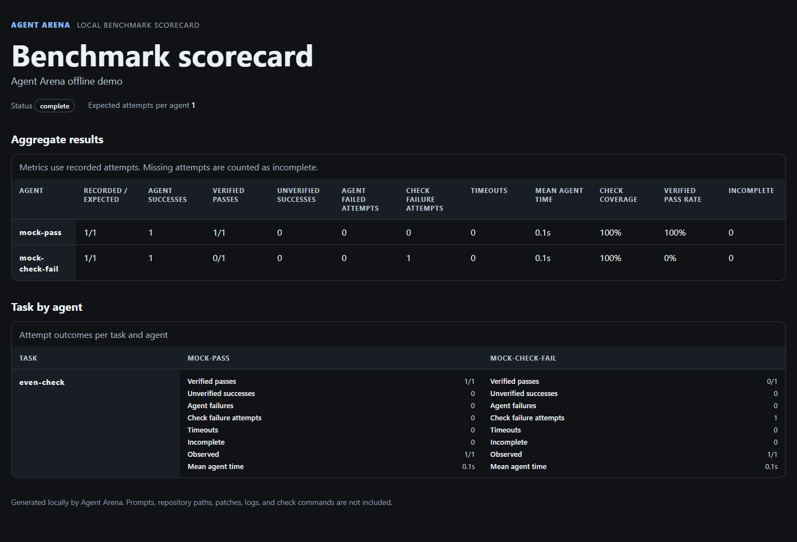

# Agent Arena

**Compare coding agents against your repository's own checks.**

Agent Arena runs the same task from the same Git commit in separate worktrees, executes your
repository's checks for each patch, and creates offline reports so you can review the evidence
before choosing what to keep.

Local runs keep prompts, patches, logs, and reports on your machine. The configured agent CLI may
still send context to its provider; Agent Arena does not control that provider's behavior.

[](https://www.python.org/)
[](LICENSE)
[](#project-status)

Example output from the offline demo: one mock agent passes the repository checks, while the
other fails a check.



## Project status

Early development. Agent Arena can run configured commands locally or in optional Docker containers, compare their Git worktrees, run repeatable benchmark suites, and check local run prerequisites with `arena doctor`. Package release automation is in place; one-time PyPI Trusted Publishing setup and a first version tag are still required before installing from PyPI.

Trying it? [Share first-run feedback](https://github.com/DreyzeDev/agent-arena/issues/new?template=first-run-feedback.yml).
GitHub issues are public; do not include prompts, code, patches, logs, or credentials.

## Why Agent Arena?

Fixed benchmark scores do not show whether a patch passes the checks in your own repository. Agent
Arena makes that comparison repeatable:

- Give each agent the same task and starting commit in its own Git worktree.
- Run the same configured checks against each patch.
- Distinguish verified passes from unverified output, failed checks, and incomplete attempts.
- Review the patches and check evidence locally before choosing what to keep.

The first release focuses on local, reproducible runs and optional Docker execution. A hosted leaderboard and shared public benchmark corpus can come later.

## Planned workflow

```text
Task + repository
        │
        ├── Agent A → isolated worktree → patch + checks
        ├── Agent B → isolated worktree → patch + checks
        └── Agent C → isolated worktree → patch + checks
                              │
                    compare and review
```

## Quick start

Requires Python 3.11+ and Git. Provider CLIs are needed only when you run those providers; the
built-in demo uses local mock agents.

If you have [pipx](https://pipx.pypa.io/latest/how-to/install-pipx.html) installed, try the current
GitHub version without setting up a local checkout:

```bash
pipx run --spec git+https://github.com/DreyzeDev/agent-arena.git arena demo --open
```

This fetches the project and dependencies, then runs the demo in a pipx-managed environment. It
uses the latest `main` branch, not a versioned release. If pipx selects Python below 3.11, pass
`--python 3.11` before `--spec` (or choose another installed Python 3.11+ version).

To inspect or modify the source, clone the repository:

```bash
git clone https://github.com/DreyzeDev/agent-arena.git
cd agent-arena
```

Create and activate a virtual environment, then install Agent Arena:

```bash
# macOS / Linux
python3 -m venv .venv
source .venv/bin/activate
python -m pip install -e .
```

```powershell
# Windows PowerShell
python -m venv .venv
.\.venv\Scripts\Activate.ps1
python -m pip install -e .
```

Verify the installation and inspect a real benchmark without API keys or provider CLIs:

```bash
arena demo --open
```

Initialize the repository you want to work on:

```bash
arena init --path /path/to/your/repository
```

On Windows PowerShell, use a Windows path and run each command on one line:

```powershell
$repo = "C:\path\to\your\repository"
arena init --path $repo
arena doctor --repo $repo --agent codex --agent claude
arena run --repo $repo --task "Fix the bug described in issue #42" --agent codex --agent claude
arena runs --repo $repo
```

Before running `arena doctor` or `arena run`, the selected repository needs at least one Git commit
to use as the shared base. Create an initial commit first when starting from an empty repository.

After `arena run` prints a run ID, inspect or export a result with PowerShell like this:

```powershell
arena report RUN_ID --repo $repo --open
arena export RUN_ID --repo $repo --agent codex
```

The starter config includes `codex` and `claude` command profiles. Install and sign in to the
provider CLIs you plan to use, then check that their commands in `.agent-arena.toml` match your
setup. Agent Arena starts those commands; each provider CLI manages its own authentication. Check
local prerequisites before starting a run:

```bash
arena doctor --repo /path/to/your/repository --agent codex --agent claude

arena run \
  --repo /path/to/your/repository \
  --task "Fix the bug described in issue #42" \
  --agent codex \
  --agent claude

arena runs --repo /path/to/your/repository
arena report RUN_ID --repo /path/to/your/repository --open
arena export RUN_ID --repo /path/to/your/repository --agent codex
arena benchmark --repo /path/to/your/repository --suite benchmarks/suite.toml
arena benchmark-report BENCHMARK_ID --repo /path/to/your/repository --open
arena demo --open
```

The target repository must be clean, except for an untracked config file. Runs start from its current HEAD commit. Each agent gets a detached worktree, and all agents run concurrently. Patches and logs are saved under the operating system's temporary directory in an agent-arena folder.

A run can include up to 16 agents. Use --timeout to set the per-command limit; the maximum is 24 hours. Agent commands receive a minimal environment by default, with opt-in environment variable names available per profile.

Provider integrations can be installed as Python plugins. See the [provider adapter guide](docs/provider-adapters.md) for the public API, plugin registration, and configuration format. Run `arena adapters` to list installed adapters.

Optional checks can be added to the top level of .agent-arena.toml:

```toml
checks = [["python", "-m", "pytest", "-q"], ["ruff", "check", "."]]
```

Check commands run separately in each agent's worktree after the agent command finishes.

For multi-task comparisons, commit a TOML suite in the target repository or keep it outside the
repository, then run `arena benchmark`. See the [benchmark guide](docs/benchmarks.md) for the
suite format, result metrics, and artifact layout.

Try `arena demo` for a real benchmark without configuring an agent provider. It creates a small
temporary Git repository, runs two deterministic mock agents against it, checks their changes, and
saves an offline scorecard plus per-run report in the system temporary directory. It does not use
API keys, Docker, or network calls, and it leaves the repository where you ran the command alone.
See the [demo guide](docs/demo.md) for details.

## Roadmap

- [x] Publish the project scaffold and contribution guidelines.
- [x] Add CLI setup and local parallel runs in Git worktrees.
- [x] Capture patches, logs, exit codes, elapsed time, and optional check results.
- [x] Define a provider adapter plugin contract and entry-point discovery.
- [x] Add configurable checks.
- [x] Add an offline side-by-side HTML report.
- [x] Export a selected agent patch as a local branch.
- [x] Add versioned benchmark suites with checks and aggregate CSV/JSON results.
- [x] Generate an offline HTML scorecard with per-task, per-agent benchmark outcomes.
- [x] Add an optional Docker runner with explicit network and resource limits.
- [x] Add a manual GitHub Actions workflow that uploads aggregate benchmark metrics.

See [the roadmap](docs/roadmap.md) and [the architecture notes](docs/architecture.md).
See [the export guide](docs/exports.md) to save a selected result as a branch.
See [the container guide](docs/containers.md) to configure Docker execution.
See [the GitHub Actions guide](docs/github-actions.md) to run benchmarks in CI.
See [the provider adapter guide](docs/provider-adapters.md) to add provider integrations.
See [the environment doctor guide](docs/doctor.md) for local setup checks and their limits.
See [the package release guide](docs/releasing.md) for PyPI Trusted Publishing setup and release steps.
See the [changelog](CHANGELOG.md) for the planned first release contents.

## Security model

Git worktrees separate file changes; they do **not** sandbox a process. Local mode runs commands with the permissions of the user who starts them. Docker mode restricts mounted files, network, capabilities, and resource use, but containers still share the host kernel and are not a complete security boundary. Use trusted images, tools, and repositories.

Agent Arena will not ask users to paste model API keys into its configuration. Provider authentication should stay with the provider's own CLI or credential manager.

Run artifacts include the task prompt, agent output, and generated patch. They are stored locally under the system temporary directory; review them before sharing.

Child processes receive a small set of operating-system environment variables by default. To pass a specific credential variable to an agent, add its name to that profile's inherit_env list; the value is read from your current environment and is never copied into the run manifest. Agent Arena redacts exact allowlisted values from saved stdout and stderr logs, but tools can transform or encode secrets. Check commands do not receive profile-specific credentials.

## Contributing

Issues and pull requests are welcome. Start with [CONTRIBUTING.md](CONTRIBUTING.md), and use the issue templates for bugs and feature proposals.
Interested in testing the first-run workflow? See the [user validation protocol](docs/user-validation.md).

Pull requests are configured to run Ruff lint, formatting, and tests on Ubuntu 24.04 and Windows
with Python 3.11, 3.12, 3.13, and 3.14. The Windows job also runs `arena demo`. Dependabot checks
Python and GitHub Actions dependencies weekly.

## License

Agent Arena is released under the [MIT License](LICENSE).
